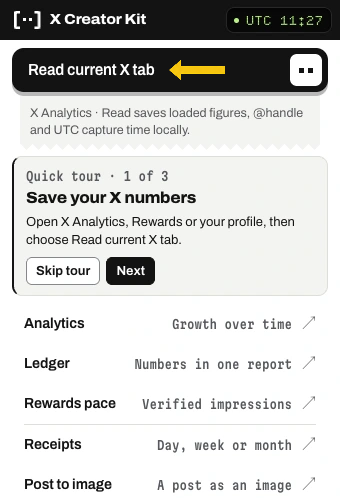

# X Creator Kit

Save the X Analytics days you care about, turn them into a receipt, or draft a reply in your own voice. X Creator Kit is a free extension for desktop Chrome. Visit the [product website](https://xcreatorkit.com/) for examples.

**[Install from the Chrome Web Store](https://chromewebstore.google.com/detail/x-creator-kit/pindijhdegpamfbgdaoaaahaljbombpe)** · [First read](#your-first-read) · [Build from source](#build-from-source) · [Contribute](CONTRIBUTING.md)

## Your first read

1. Install the extension and open [X Analytics](https://x.com/i/account_analytics) in your own account. Leave the verified-only filter off for your first read and wait for the chart to load.
2. With that tab active, open **X Creator Kit** from Chrome’s Extensions menu and choose **Read current X tab**. The popup reports how many days it saved.
3. Open **Analytics** to see those days. Read another date range to add to your history. **Ledger** uses those same all-viewer readings to make a summary card.



The [illustrated walkthrough](https://xcreatorkit.com/guide/) covers setup and every tool.

## What you can do

| Tool | What it does |
| --- | --- |
| [Analytics](https://xcreatorkit.com/analytics/) | Save the days loaded in X Analytics, compare periods, and export a chart. Missing days stay blank. |
| [Ledger](https://xcreatorkit.com/ledger/) | Put a saved range on one summary card and download the PNG. |
| [Rewards pace](https://xcreatorkit.com/rewards-pace/) | Track X’s separate 90-day Verified Home Timeline impressions figure. A reading 2–10 UTC days before the latest one lets the kit calculate a straight-line pace. |
| [Receipts](https://xcreatorkit.com/receipts/) | Print a daily growth receipt, or make a [week or month recap](https://xcreatorkit.com/recaps/) from saved days. |
| [Post to image](https://xcreatorkit.com/post-to-image/) | Right-click a supported post, choose a look, and download it as an image. |
| [Reply drafter](https://xcreatorkit.com/reply-drafter/) | Open a post in the side panel, draft an English reply using your saved voice preferences, then edit and copy it. You paste and post it yourself. |
| [Follow-back check](https://xcreatorkit.com/follow-back/) | Highlight loaded rows on your own Following page using X’s “Follows you” badge. |

## Privacy and model choices

Readings stay in your browser. Dates use UTC, and the kit reads the current Analytics, Rewards, or profile page when you press **Read current X tab**. Post selection and Following highlights use optional X access.

Reply drafting is opt-in. On supported devices, Chrome can download a model and draft on-device. You can also connect your own Gemini key for a billing-enabled project. Cloud drafting sends the selected post text and reply context directly to Google. The key stays in the editor’s memory. See [what is sent and when](https://xcreatorkit.com/privacy.html#reply-beta) and the [extension manifest](static/manifest.json).

## Build from source

Use Node.js 22 and npm. From a terminal:

```sh
git clone https://github.com/AaravKashyap12/xcreatorkit-extension.git
cd xcreatorkit-extension
npm ci
npm run build
```

Open `chrome://extensions`, enable **Developer mode**, choose **Load unpacked**, and select the generated `dist/` folder. After editing the source, rebuild and click **Reload** on the extension card.

## Find your way around

- [Extension screens](src/ui/), [reply side panel](src/reply/), and [manifest and page HTML](static/)
- [Capture code](src/capture/), [local storage](src/store/), and [calculations](src/calc/)
- [Receipt renderer](src/receipt/), shared by the extension and PNG exports
- [test fixtures](test/fixtures/), and [browser verifiers](scripts/)
- [Contributor guide](CONTRIBUTING.md), [extension design rules](docs/v1/EXTENSION-READER.md), and [issue tracker](https://github.com/AaravKashyap12/xcreatorkit-extension/issues)

## License

X Creator Kit’s original code and documentation are available under the [MIT License](LICENSE). Fonts and third-party libraries retain their [respective licenses](THIRD_PARTY_NOTICES.md).
